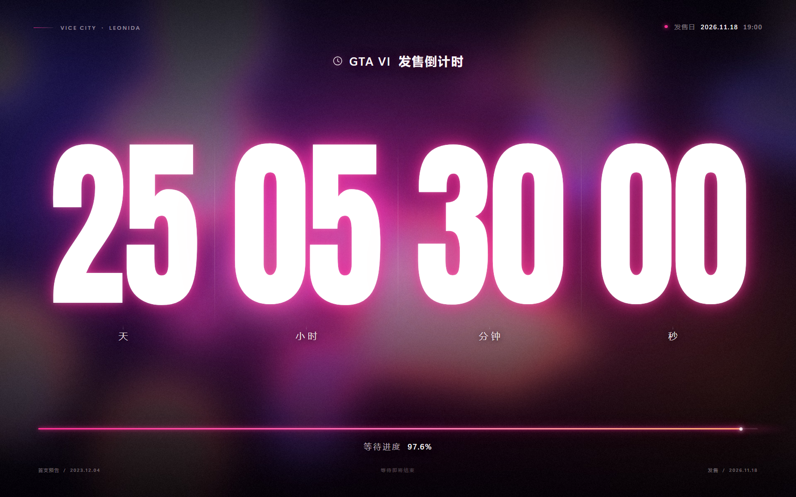
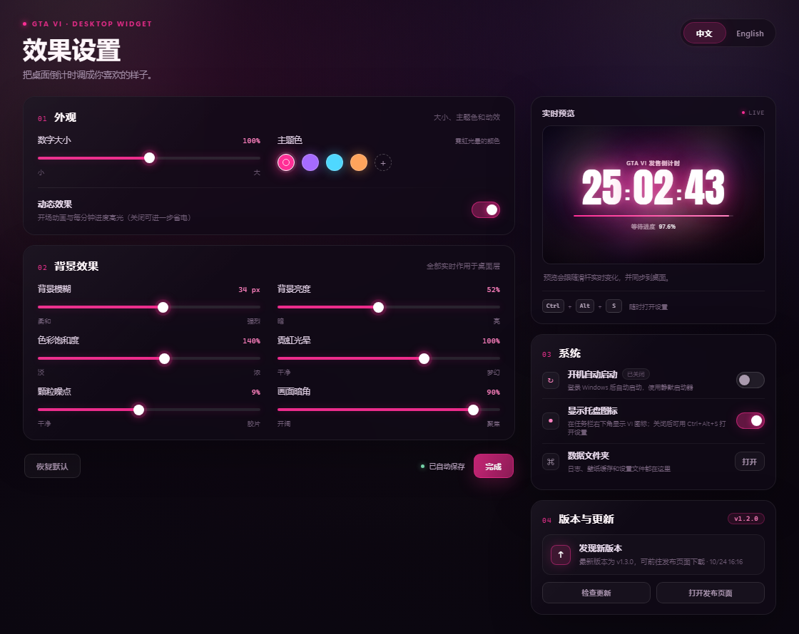

<div align="center">

# GTA VI 桌面倒计时

**把等待发售的每一天，变成桌面上的一件作品。**

A cinematic, wallpaper-reactive GTA VI countdown for Windows.


[效果预览](#效果预览) · [功能](#功能) · [快速开始](#快速开始) · [效果设置](#效果设置) · [性能](#性能) · [从源码构建](#从源码构建) · [FAQ](#faq)

</div>

---

## 这是什么

一个真正贴在 Windows 桌面上的 **GTA VI 发售倒计时**。它不是普通窗口，而是挂在壁纸与桌面图标之间的全屏视觉层：

- 读取你当前的 Windows 壁纸，做高斯模糊、调色、暗角与胶片颗粒；
- 用超大 Anton 数字、霓虹 bloom、细进度条还原电影感排版；
- 打开其他窗口时安静地留在桌面层，不抢焦点、不占任务栏；
- 附带一个完整的可视化设置面板，实时预览并同步到桌面。

截止时间：**2026-11-18 19:00（Asia/Shanghai，UTC+8）**。到点后自动切换为「GTA VI 现已发售」。

> 粉丝自制项目，与 Rockstar Games / Take-Two Interactive 无关联，不包含任何官方游戏素材。GTA VI 及相关商标归其权利人所有。

## 效果预览

| 桌面效果 | 效果设置 |
| :---: | :---: |
| [](preview.png) | [](settings-preview.png) |

## 功能

### 倒计时

- 精确到秒的实时倒计时，固定按 UTC+8 计算，不依赖系统时区。
- 等待进度从 `2023-12-04 22:00`（GTA VI 首支预告片上线）开始计算，目前显示 **97.6%**。
- 到点后自动切换为发售状态，并保持 `100%` 进度。

### 视觉

- 以真实桌面壁纸为底，自动同步壁纸更换。
- 高斯模糊、亮度、饱和度、暗角、胶片颗粒均可调。
- 霓虹数字可选粉、紫、青、橙四种主题色，也支持自定义颜色。
- 数字大小、动态效果开关、实时预览。
- 全屏响应式排版，适配 16:9、16:10 与宽屏显示器。

### 系统

- **真正的桌面层**：Windows 11 24H2+ 使用 raised desktop 拓扑挂载到 `Progman` 的图标与壁纸之间；经典 Windows 10/11 拓扑回退到 `WorkerW`。
- **托盘图标**：右下角显示自定义 VI 图标，可打开设置、刷新壁纸、隐藏桌面图标、开机自启或退出。
- **托盘图标可隐藏**：关闭后仍可用 `Ctrl + Alt + S` 或桌面快捷方式打开设置。
- **中英双语**：设置界面、托盘菜单、桌面倒计时文字同步切换。
- **开机自启**：通过带 AUMID 的开始菜单快捷方式静默启动，不弹控制台；不需要管理员权限。
- **单实例**：程序已在运行时再次双击快捷方式，会直接打开设置，不会出现第二层倒计时。
- **版本与更新**：设置里有版本卡片，可手动检查更新；发现新版本时桌面上会短暂浮现提示卡。完整记录见 [CHANGELOG.md](CHANGELOG.md)。
- **隐私优先**：除可选的版本检查外不联网；版本检查只读取 GitHub Releases 的最新版本号，最多每 12 小时一次，失败时静默跳过。
- **低占用**：背景只烘焙一次为静态图片，没有全屏循环动画；空闲 GPU 接近 0。

## 快速开始

### 运行环境

- Windows 10 / 11 **x64**
- [.NET 10 Desktop Runtime](https://dotnet.microsoft.com/download/dotnet/10.0)
- [Microsoft Edge WebView2 Runtime](https://developer.microsoft.com/microsoft-edge/webview2/)（Windows 11 和大多数更新过的 Windows 10 已自带）

> 当前发布是 framework-dependent 版本。如果目标电脑没有 .NET 10 Desktop Runtime，程序无法启动；请先安装运行时，或自行使用下方命令构建 self-contained 版本。

### 安装

1. 前往仓库的 **Releases** 页面，下载最新的便携包 / 发布包。
2. 解压到任意英文路径（建议不要放在 Program Files）。
3. 双击 `launch.vbs` 启动；或者运行 `install.ps1` 安装到 `%LOCALAPPDATA%\Programs\GTA6Countdown` 并创建桌面 / 开始菜单快捷方式。
4. 回到桌面（`Win + D`）即可看到倒计时。

使用 `install.ps1` 安装后，桌面快捷方式 **「GTA VI 倒计时」** 是推荐入口。程序已经运行时再次双击它，会直接打开效果设置。

### 打开设置

- 双击任务栏右下角的 **VI** 托盘图标
- 右键托盘图标 →「效果与系统设置…」
- 按 `Ctrl + Alt + S`
- 双击桌面快捷方式（程序已在运行时）

## 效果设置

设置面板中的所有调整都会自动保存，并实时同步到桌面层。

| 控件 | 说明 |
| --- | --- |
| 数字大小 | 75%–125% |
| 主题色 | 粉 / 紫 / 青 / 橙 + 自定义取色 |
| 动态效果 | 开场动画与每分钟一次进度高光 |
| 背景模糊 | 0–60 px |
| 背景亮度 | 控制壁纸明暗，保证数字可读 |
| 色彩饱和度 | 调整壁纸整体色彩浓度 |
| 霓虹光晕 | 数字 bloom 强度 |
| 颗粒噪点 | 胶片颗粒强度 |
| 画面暗角 | 四周压暗程度 |
| 显示托盘图标 | 隐藏右下角 VI 图标 |
| 开机自动启动 | 登录 Windows 后自动启动 |

配置文件位于：

```text
%LOCALAPPDATA%\GTA6Countdown\settings.json
```

### 版本与更新

设置窗口右侧的「版本与更新」卡片：

- 显示当前版本（本版为 `v1.2.0`）与最近一次检查时间
- **检查更新**：立即查询 GitHub 最新 Release
- **打开发布页面**：跳到最新版本下载

程序启动后会自动检查（间隔 12 小时），发现新版本时桌面上会淡入一张提示卡，约 8 秒后自动淡出。

> 仓库发布前，请把 `app/UpdateService.cs` 顶部的 `GitHubOwner` / `GitHubRepository` 改成你自己的仓库地址；未配置时卡片会显示「开发版本未配置发布源」。

## 开机自启：开启 / 取消

推荐在设置中操作：

1. 打开「效果设置」→ 右侧「系统」。
2. 打开或关闭 **开机自动启动**。
3. 开关立即生效，自动保存。

也可以用托盘菜单中的 **开机自动启动** 快速切换。

如果程序没有运行、但需要手动清理：

```powershell
reg delete "HKCU\Software\Microsoft\Windows\CurrentVersion\Run" /v GTA6Countdown /f
```

启动项名称为 `GTA6Countdown`，只影响当前用户，不涉及管理员权限或系统级服务。

## 在其他电脑上运行

可以，但请注意当前版本是 **.NET 依赖版**：

1. 安装 .NET 10 Desktop Runtime 和 WebView2 Runtime。
2. 复制整个 `GTA6Countdown` 文件夹（`launch.vbs`、`GTA6Countdown.dll`、`assets` 必须放在一起）。
3. 运行 `launch.vbs`。
4. 开机自启、快捷方式和任务栏名称需要在目标电脑上重新生成。

如果不想在目标电脑安装 .NET，可以构建 self-contained 版：

```powershell
dotnet publish -c Release -r win-x64 --self-contained true -p:PublishSingleFile=false -o ..\dist\GTA6Countdown-SelfContained
```

self-contained 版会包含 .NET 运行时，体积约 200MB，但仍然需要 WebView2 Runtime。

## 从源码构建

### 环境

- .NET 10 SDK
- Windows 10/11
- WebView2 Runtime

### 构建

在仓库根目录执行：

```powershell
cd app
dotnet publish -c Release -r win-x64 --self-contained false -p:PublishSingleFile=false -o ..\dist\GTA6Countdown
Copy-Item ..\tools\launch.vbs ..\dist\GTA6Countdown\launch.vbs -Force
```

然后安装：

```powershell
cd ..
powershell -ExecutionPolicy Bypass -File .\install.ps1
```

`install.ps1` 会：

- 把发布文件复制到 `%LOCALAPPDATA%\Programs\GTA6Countdown`；
- 创建桌面和开始菜单快捷方式；
- 为快捷方式写入 AUMID，让任务栏显示「GTA VI 倒计时」而不是「.NET Host」；
- 启动倒计时。

开发调试可以直接运行：

```powershell
dotnet run --project app
```

## 项目结构

```text
gta6-widget/
├─ app/                         WPF 宿主 + WebView2 控件
│  ├─ MainWindow.xaml(.cs)      全屏桌面层
│  ├─ SettingsWindow.xaml(.cs)  效果设置窗口
│  ├─ DesktopHost.cs            Progman / WorkerW 挂载与回退
│  ├─ WallpaperService.cs       壁纸读取、缩放、JPEG 缓存
│  ├─ BackgroundRenderer.cs     模糊/调色/颗粒烘焙为静态背景
│  ├─ SettingsService.cs        设置持久化
│  ├─ UpdateService.cs          GitHub Release 版本检查
│  ├─ UpdateHud.cs              桌面「发现新版本」提示
│  ├─ AppIdentity.cs            AppUserModelID / 任务栏身份
│  └─ assets/                   HTML/CSS/JS 界面、字体、图标
├─ tools/launch.vbs             静默启动器
├─ install.ps1                  安装 / 快捷方式 / AUMID
├─ uninstall.ps1                卸载
├─ preview.png                  桌面效果截图
├─ settings-preview.png         设置界面截图
├─ CHANGELOG.md                 更新日志
├─ LICENSE                      MIT
└─ README.md
```

## 工作方式

1. WPF 创建一个无边框、无任务栏按钮的全屏窗口。
2. 启动时读取当前 Windows 壁纸，由 `BackgroundRenderer` 在 CPU 上一次性完成高斯模糊、调色、光晕、暗角和颗粒。输出尺寸等于当前显示器的物理分辨率，JPEG 质量 96。
3. WebView2 页面只显示这张静态背景和文字，不再在每一帧重新计算全屏 CSS 滤镜。
4. 通过 Win32 检测桌面拓扑，把窗口挂到桌面图标之下：
   - Windows 11 24H2+：`Progman` 的 raised desktop，窗口置于图标视图与壁纸 WorkerW 之间；
   - 经典拓扑：`WorkerW`。
5. 设置窗口通过 WebView2 `postMessage` 把变更回传给 WPF，写入 JSON，需要时重新烘焙背景并实时推回主界面。
6. 通过 AppUserModelID + 带 AUMID 的快捷方式把任务栏图标/名称改成项目自己的身份。

## 性能

这一版专门针对 GPU 占用做了低功耗优化：

- **静态背景**：壁纸模糊、调色、光晕、暗角和颗粒在启动或设置改变时只计算一次，保存为一张与显示器物理分辨率等大、质量为 96 的 JPEG。
- **无全屏循环动画**：移除了壁纸漂移、光晕呼吸、bokeh 浮动和颗粒抖动。动态效果只保留一次性开场动画与每分钟一次的进度高光。
- **按需重绘**：秒数每秒更新一次；天、小时、分钟只在数值变化时更新。
- **本机测试**：优化后主界面 WebView2 的空闲 GPU 平均 **低于 0.1%**（实测约 0.003%–0.03%），CPU 约 **1%–2%**（单核占比）；具体数值会随硬件和 Windows 版本浮动。
- 设置窗口中的实时预览是临时界面，关闭后即释放。

## FAQ

**任务栏还是显示 .NET Host？**  
请从 `install.ps1` 创建的桌面/开始菜单快捷方式启动。程序已注册 AUMID，但 Windows 任务栏可能缓存旧身份；退出后重新从快捷方式启动即可。

**托盘图标不见了？**  
按 `Ctrl + Alt + S`，或双击桌面快捷方式，设置窗口会重新出现；在「系统」里重新打开「显示托盘图标」。

**开机自启怎么取消？**  
设置 →「系统」→ 关闭「开机自动启动」；或删除 `HKCU\Software\Microsoft\Windows\CurrentVersion\Run` 下的 `GTA6Countdown`。

**桌面没有变化？**  
按 `Win + D` 回到桌面；如果 Explorer 刚重启过，双击快捷方式重新启动。

**支持多屏吗？**  
当前版本固定使用主屏。多屏独立布局还没有实现。

**支持其他壁纸格式吗？**  
支持 Windows 能正常显示为图片的壁纸；纯色背景暂不支持。壁纸变化后会自动同步。

## 已知限制

- 仅支持 Windows 10 / 11 x64。
- 当前发布依赖 .NET 10 Desktop Runtime 与 WebView2 Runtime。
- Explorer 重启会销毁桌面层，需要重新启动程序。
- 任务栏名称/图标依赖安装脚本创建的 AUMID 快捷方式。
- 主屏优先，暂未实现多显示器独立倒计时。

## Credits

- 字体：[Anton](https://fonts.google.com/specimen/Anton)，SIL Open Font License 1.1，许可证全文见 [app/assets/fonts/OFL.txt](app/assets/fonts/OFL.txt)。
- 运行时：[.NET](https://dotnet.microsoft.com/) 与 [Microsoft Edge WebView2](https://developer.microsoft.com/microsoft-edge/webview2/)。
- 设计灵感来自 GTA VI 的视觉语言；本项目不包含任何官方素材。

## License

代码采用 [MIT](LICENSE)。Anton 字体采用 SIL OFL 1.1。  
GTA VI、Rockstar Games 及相关名称/商标归 Take-Two Interactive 所有，本项目为非官方粉丝作品。

---

<details>
<summary><strong>English overview</strong></summary>

### GTA VI Desktop Countdown

A fan-made, wallpaper-reactive GTA VI countdown that lives on the Windows desktop. It sits between the wallpaper and desktop icons, stays out of the taskbar, and reacts to the wallpaper you already use.

**Highlights**

- Live countdown to `2026-11-18 19:00 UTC+8`.
- Real wallpaper background with blur, grading, grain, vignette and neon glow.
- Full settings GUI with live preview, accent colors and effect intensity sliders.
- Chinese / English UI.
- Optional tray icon, autostart, and single-instance behavior.
- Native Windows 11 raised-desktop / classic WorkerW integration.
- No network requests at runtime.

**Requirements**

- Windows 10 / 11 x64
- .NET 10 Desktop Runtime
- Microsoft Edge WebView2 Runtime

**Build**

```powershell
cd app
dotnet publish -c Release -r win-x64 --self-contained false -p:PublishSingleFile=false -o ..\dist\GTA6Countdown
Copy-Item ..\tools\launch.vbs ..\dist\GTA6Countdown\launch.vbs -Force
cd ..
powershell -ExecutionPolicy Bypass -File .\install.ps1
```

**License**

MIT for the code. Anton font under SIL OFL 1.1.  
This is an unofficial fan project, not affiliated with Rockstar Games or Take-Two Interactive.

</details>
